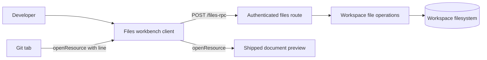
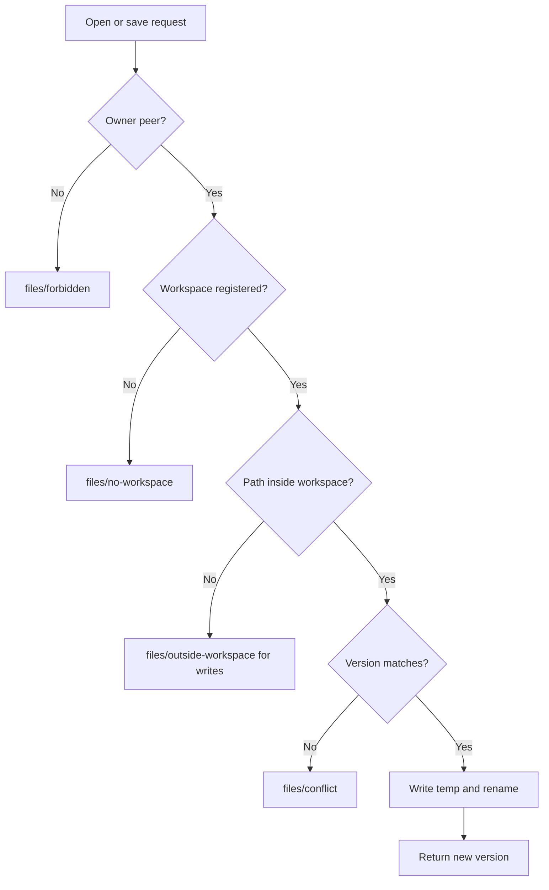
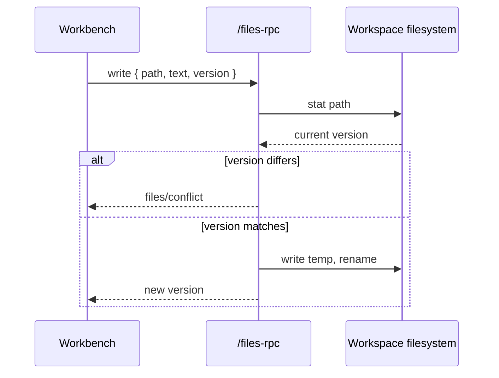

# Files workbench

> A right-sidebar workspace browser and code editor for DeepSeek Harness, so a file the agent changed can be opened at the exact line, edited, saved, and previewed without leaving the conversation.

**Status legend.** Every `Status` value below is one of: **Current** (read in the code at `last_verified_commit`) · **Planned** (not implemented) · **Inferred** (not directly verified) · **Unknown**.

## 1. Feature Snapshot

| Field | Details |
| --- | --- |
| Document status | Active |
| Implementation status | Shipped; live verified 2026-11-10 (no commit) |
| Owner | Parth Patel |
| Primary actors | Developer using the harness in a local workspace |
| Trigger | Mod+P, the guide card, a file link, or a Git diff line |
| Outcome | The file is open in a CodeMirror editor and can be saved, renamed, moved, copied, deleted, or previewed |
| Entry points | Right-sidebar `files` tab (taken over), `editor` resource tabs, shared file and directory context menus |
| Data stores | Host filesystem under the workspace root; browser `localStorage` for editor preferences and drafts |
| Feature flag | None. The plugin is installed in the `web` profile |
| Last verified | 33 local tests and a live pass on 2026-11-10 |

## 2. Problem and Outcome

**Problem.** The harness ships a file browser and a document preview, but neither edits. Reviewing an agent's change, correcting one line, and saving it means leaving the conversation for an IDE.

**Desired outcome.** The developer browses the session workspace, opens any text file in an editor, saves it with a conflict check, manages files from the tree, previews Markdown, HTML, images, and PDF with the shipped preview, and jumps from a Git diff to the same file at the same line.

**How success is measured.** The user opens the workbench, edits and saves a file, renames and deletes files, and opens a Git diff line in the editor, with no console errors and no lost content. This is checked by the tests in §20 and one live pass.

## 3. Scope

**Included**

- Take over sidebar tab kind `files` with a workbench: header, workspace tree, editor pane, status bar.
- Text file editing with CodeMirror 6, syntax highlighting for common languages, find and replace, cursor status.
- Versioned save with conflict detection, autosave, Ctrl+S, draft recovery.
- File operations: new file, new folder, rename, duplicate, cut, copy, paste, delete.
- Shared context-menu actions for `file` and `directory` targets.
- A `editor` resource tab type at the extension band so text addresses from chat and Git open the editor.
- Open at line for resource tabs, plus a `files` page parameter that reveals a path.
- Markdown, HTML, images, PDF, Office, CSV stay on the shipped preview and gain an Edit action.
- English and Chinese strings, harness tokens for all colors.

**Excluded**

- Search across file contents, quick-open file picker, split editors, multi-cursor.
- LSP diagnostics, completion, hover, definition navigation.
- Drag and drop file moves, multi-select, inline rename.
- Debugger, test runner, integrated terminal (the harness already has a terminal tab).
- Writes outside the workspace root.
- Remote, SSH, or container filesystems.

**Assumptions**

| ID | Assumption | Confidence | How it gets validated |
| --- | --- | --- | --- |
| ASM-001 | A tab type may take over kind `files` at the extension band while the built-in resumes on unload | High | Read the tab registry bands and `coexists` in `dsh-client-ui-sidebar-right`; live check after install |
| ASM-002 | `renderFactorySlot('sidebar.files.tree', ...)` is available to any plugin that injects the files package | High | README contract; live check |
| ASM-003 | CodeMirror 6 bundles into the loader format and renders without the host's React | High | Bundled 14 languages, rendered and edited in jsdom |
| ASM-004 | An authenticated prefix route can write workspace files under the current policy | High | 20 host-route probes passed |
| ASM-005 | `openResource(address, { params: { line } })` reaches a tab body as `tab.navigation.params.line` | High | Read the sidebar-right contract and documentpreview usage |

## 4. Terminology

- **Workspace root**: the `workspace.path` of the session's registered workspace. The write boundary.
- **Workbench**: the `files` page body: header, tree, editor area, status bar.
- **Buffer**: one open file in the workbench, with text, version, encoding, line ending, dirty flag, and cursor.
- **Version**: an opaque string `${ino}:${size}:${mtimeNs}` identifying one file state. Save compares it.
- **Takeover**: an extension-band registration for a kind a builtin already holds. The extension is in force while loaded.
- **Native preview**: the shipped `text` resource tab type that renders documents.

## 5. Actors and Permissions

| Actor | Can do | Limits |
| --- | --- | --- |
| Local owner | Everything in this document | The route admits only an owner peer |
| Remote browser peer | Nothing | `files/forbidden` |
| Agent | Edits files through its own tools | The editor detects the resulting version change and never overwrites it silently |

## 6. User Journey

1. The developer presses Mod+P, picks the Files guide card, or clicks a file link.
2. The workbench opens at the session's working directory and lists the root level.
3. They expand directories and click a file. A text file opens in a buffer; an image, PDF, Office file, or CSV opens in the native preview.
4. They edit. The buffer turns dirty and autosave fires, or they press Ctrl+S.
5. The host compares the buffer version with the file version, writes atomically, and returns a new version.
6. If an agent changed the file meanwhile, a conflict banner offers Reload or Overwrite.
7. They right-click a row to create, rename, duplicate, cut, copy, paste, or delete.
8. From a Git diff, they press Open in editor. The editor tab opens at the same line.

**Alternate paths**

| Journey | Trigger | Expected outcome |
| --- | --- | --- |
| External change while clean | Agent writes the file | Buffer reloads and keeps the cursor when possible |
| External change while dirty | Agent writes the file | Conflict banner, no automatic overwrite |
| Save conflict | File version changed | `files/conflict`, banner, explicit choice |
| File removed | File deleted on disk | Banner with Save as new or close, no crash |
| Read-only file | Path outside the workspace | Editor opens read-only with a reason |
| Binary or large file | NUL byte or over 5 MB | Editor tab shows the preview action instead |

## 7. System Context



The client never touches the filesystem directly. The host route resolves the workspace, checks containment, and performs the operation.

## 8. Control Flow



| Step | Status | Controlling component | Failure behavior |
| --- | --- | --- | --- |
| Admission | Planned | `src/host/lib/http.ts` via `ctx.connection.admit` | 401 or forbidden envelope |
| Workspace resolution | Planned | `src/host/lib/rpc.ts` via `ctx.workspaceRegistry` | `files/no-workspace` |
| Containment | Planned | `src/host/lib/paths.ts` | `files/outside-workspace` |
| Version check | Planned | `src/host/lib/ops.ts` | `files/conflict`, file untouched |
| Atomic write | Planned | `src/host/lib/ops.ts` | Temp removed, original untouched |

## 9. Data Flow

Save path across components:



**Sensitive data.** File contents and paths stay on the local machine. They are not logged, sent to a model, or stored outside `localStorage` drafts. Drafts are cleared after a successful save and on buffer close.

## 10. State Model

| State | Where | Transition |
| --- | --- | --- |
| Tree level: `loading` | Client store | `ready` or `failed` after list |
| Tree level: `ready` | Client store | `loading` on refresh |
| Buffer: `clean` | Client store | `dirty` on document change |
| Buffer: `dirty` | Client store | `saving` on save |
| Buffer: `saving` | Client store | `clean` on success, `conflict` on version mismatch |
| Buffer: `conflict` | Client store | `clean` after reload or overwrite |
| Buffer: `readOnly` | Client store | Terminal until reload |
| Page: `empty` | Page body | `editor` after a file opens |

## 11. Implementation Map

The feature is new, so this repository has no pre-existing implementation paths. The harness contracts it builds on are external packages; each was read in the installed bundle and is marked Inferred because this document has no verified commit.

### External contracts

| Contract | Package | Main symbol | Status |
| --- | --- | --- | --- |
| Tab kinds, bands, resource patterns | `@deepseek-ai/dsh-client-ui-sidebar-right` | tab registry | Inferred |
| Reusable tree rows | `@deepseek-ai/dsh-client-ui-sidebar-files` | `sidebar.files.tree` factory | Inferred |
| Context menu targets | `@deepseek-ai/dsh-client-ui-context-menu` | menu registry | Inferred |
| Document preview and line navigation | `@deepseek-ai/dsh-client-ui-sidebar-documentpreview` | `text` type | Inferred |
| Authenticated route admission | `@deepseek-ai/dsh-client-connection` | `admit`, `rpc` | Inferred |

### Implemented

| Layer | Responsibility | Path | Main symbol | Status |
| --- | --- | --- | --- | --- |
| Bundle manifest | Package metadata, patch, client injection | `package.json`, `cordis.patch.yml` | bundle row `dsh-files-desk` | Inferred |
| Host entry | Route registration | `src/host/index.ts` | `apply` | Inferred |
| Host route | Authenticated envelope and dispatch | `src/host/lib/http.ts`, `src/host/lib/rpc.ts` | `registerFilesRoute`, `createHandler` | Inferred |
| Host operations | Versioned read, write, and file operations | `src/host/lib/ops.ts`, `src/host/lib/paths.ts`, `src/host/lib/errors.ts` | `readText`, `writeText`, `renameEntry` | Inferred |
| Client bundle | Tab types, bodies, menus, editor host | `src/client/`, built `client.js` | `apply`, `FilesWorkbench`, `EditorTab` | Inferred |
| Editor chunk | CodeMirror and languages, lazy loaded | `src/client/editor/entry.ts`, built `client.editor.js` | `createEditor` | Inferred |
| Error boundary | Keeps a render failure inside the pane | `src/client/boundary.tsx` | `SurfaceBoundary` | Inferred |
| Build | esbuild wrapper for the module loader | `scripts/build.mjs` | build script | Inferred |
| Tests | Host rules, HTTP envelope, client, editor, menus | `tests/` | `host.test.mjs`, `http.test.mjs`, `client.test.mjs`, `editor.test.mjs`, `workbench.test.mjs` | Inferred |
| Git integration | Open at line from a diff | `dsh-git/client.js` (separate repository) | `fileAddressFor`, `onOpen` | Inferred |

### Generated or restricted

| Path or area | Classification | Rule |
| --- | --- | --- |
| `client.js`, `client.editor.js` | Generated | Built by `scripts/build.mjs`; never edit by hand |
| `dist/` | Generated | Compiled from `src/host/` and `src/contract.ts` by `tsc`; never edit by hand |
| `node_modules/` | Generated | Installed from `package.json` |
| `docs/features/` | Restricted | Update in the same change as behavior |

## 12. Contracts

### Route

`POST /files-rpc/<endpoint>` with the harness envelope:

```json
{ "type": "client-request", "rpcId": "string", "method": "<endpoint>", "payload": {} }
```

Success returns `{ type: "server-response", rpcId, result: { ok: true, value } }`. Failure returns `{ ok: false, error: { code, message, details } }`.

| Endpoint | Payload | Result |
| --- | --- | --- |
| `list` | `{ workspaceId, path }` | `{ path, entries: [{ name, type, size }] }` |
| `read` | `{ workspaceId, path }` | `{ path, text, version, size, eol }` |
| `write` | `{ workspaceId, path, text, version, eol }` | `{ version, size }` |
| `create` | `{ workspaceId, path, kind }` | `{ path }` |
| `rename` | `{ workspaceId, from, to }` | `{ path }` |
| `copy` | `{ workspaceId, from, to }` | `{ path }` |
| `delete` | `{ workspaceId, path }` | `{ path }` |
| `stat` | `{ workspaceId, path }` | `{ version, size, mtimeMs }` |

Error codes: `files/no-workspace`, `files/bad-request`, `files/outside-workspace`, `files/not-found`, `files/not-file`, `files/not-directory`, `files/exists`, `files/conflict`, `files/binary`, `files/not-utf8`, `files/too-large`, `files/too-many-entries`, `files/symlink`, `files/forbidden`, `files/internal`.

### Client registrations

| Registration | Key | Options |
| --- | --- | --- |
| Tab type | `dsh-files-desk`, kind `files` | `priority: 'extension'`, `keepMounted: true`, title Files, one guide entry `workspace` with `commandId: workspace.files` |
| Editor type | `dsh-files-desk/editor`, kind `editor` | `priority: 'extension'`, pattern `dsh-resource://file/[\s\S]+`, `canOpen` text allowlist |
| Page body | `sidebar.right.pane.tab` key `dsh-files-desk` | Workbench |
| Editor body | `sidebar.right.pane.tab` key `dsh-files-desk/editor` | Editor tab |
| Titles | `sidebar.right.pane.tab.title` for both keys | File type icon and name |
| Menus | `ctx.contextMenus` targets `file`, `directory` | Open, preview, new, rename, duplicate, cut, copy, paste, delete, copy path |

File address format: `dsh-resource://file/session/<encoded sessionId>/<encoded path segments>`.

Page params: `{ path?: string, line?: number }`. Resource params: `{ line?: number }`.

### Menu actions

| Action ID | Target | Behavior |
| --- | --- | --- |
| `dsh-files-desk/open` | file | Open in the editor at the captured line |
| `dsh-files-desk/preview` | file | Open the native preview |
| `dsh-files-desk/reveal` | file | Open the workbench at the file |
| `dsh-files-desk/new-file` | directory | Create a file in the directory |
| `dsh-files-desk/new-folder` | directory | Create a folder in the directory |
| `dsh-files-desk/rename` | file, directory | Rename in place |
| `dsh-files-desk/duplicate` | file | Copy with a ` copy` suffix |
| `dsh-files-desk/cut` | file, directory | Put the path on the client clipboard |
| `dsh-files-desk/copy` | file, directory | Put the path on the client clipboard |
| `dsh-files-desk/paste` | directory | Copy or move the clipboard into the directory |
| `dsh-files-desk/copy-path` | file, directory | Copy the absolute path |
| `dsh-files-desk/delete` | file, directory | Confirm and delete |

## 13. Data Model and Storage

| Key | Format | Lifetime |
| --- | --- | --- |
| `dsh-files.preferences.v1` | `{ fontSize, tabSize, wrap, autoSave }` | Browser, until cleared |
| `dsh-files.drafts.v1` | `{ [path]: { text, version, savedAt } }` | Cleared on save or explicit discard |
| `dsh-files.clipboard.v1` | `{ path, mode: 'copy' \| 'cut' }` | Session, in memory plus localStorage for reload safety |
| Workbench store | Per pane: root, levels, expanded, current, buffers, active path | In memory |

## 14. Business Rules

| Rule ID | Status | Rule | Enforcement point | Test reference |
| --- | --- | --- | --- | --- |
| BR-001 | Inferred | Every write is confined to the workspace root | `src/host/lib/paths.ts` | `tests/host.test.mjs` |
| BR-002 | Inferred | A save with a stale version is refused and the file is untouched | `src/host/lib/ops.ts` | `tests/host.test.mjs` |
| BR-003 | Inferred | A save writes a temp file and renames it, preserving mode | `src/host/lib/ops.ts` | `tests/host.test.mjs` |
| BR-004 | Inferred | Symlinks that resolve outside the root are refused for writes | `src/host/lib/paths.ts` | `tests/host.test.mjs` |
| BR-005 | Inferred | Rename and copy never overwrite an existing target | `src/host/lib/ops.ts` | `tests/host.test.mjs` |
| BR-006 | Inferred | Delete requires a confirmation and refuses the workspace root | Client dialog, `src/host/lib/ops.ts` | `tests/host.test.mjs`; confirmation untested live |
| BR-007 | Inferred | Binary, non-UTF-8, and over-5-MB files are not opened in the editor | `src/host/lib/ops.ts` | `tests/host.test.mjs` |
| BR-008 | Inferred | Only an owner peer reaches a handler | `src/host/lib/http.ts` | `tests/http.test.mjs` |
| BR-009 | Inferred | CRLF line endings round-trip, so saving does not rewrite the file | `src/host/lib/ops.ts` | `tests/host.test.mjs` |
| BR-010 | Inferred | Text addresses open the editor; images, PDF, Office, and archives open the preview | `canOpen` allowlist | `tests/client.test.mjs` |
| BR-011 | Inferred | A dirty buffer never reloads silently after an external change | `src/client/editor-host.tsx` | Untested live |
| BR-012 | Inferred | Uninstalling the plugin restores the built-in Files tab | Tab registry | Untested live |

## 15. Acceptance Criteria

### AC-001: The workbench replaces the Files tab

**Given** the plugin is installed in the web profile
**When** the developer opens the Start guide
**Then** one **Files and editor** card appears at order 10 with the Mod+P shortcut
**And** pressing Mod+P or picking that card opens the workbench with the header, tree, and editor area
**And** no duplicate Files card or second Files tab type appears

### AC-002: A directory lists lazily

**Given** the workbench is open at the workspace root
**When** the developer expands a folder
**Then** one list request is sent for that folder
**And** its rows render with folders first and names sorted

### AC-003: A text file opens and edits

**Given** a text file row
**When** the developer clicks it
**Then** the editor pane shows its content with line numbers and syntax highlighting
**And** the status bar shows the line and column

### AC-004: Save writes the file

**Given** a dirty buffer
**When** the developer presses Ctrl+S
**Then** the host writes the text atomically
**And** the buffer becomes clean with the returned version

### AC-005: Stale save is refused

**Given** a buffer whose file changed on disk
**When** the developer saves
**Then** the host returns `files/conflict`
**And** the file on disk keeps the external content
**And** the banner offers Reload and Overwrite

### AC-006: Autosave does not lose the last edit

**Given** autosave is on
**When** the developer stops typing for the debounce interval
**Then** the buffer is saved
**And** closing the tab does not prompt

### AC-007: New file and new folder

**Given** the tree is open
**When** the developer creates `notes.md` or a folder through the header or a directory menu
**Then** the entry appears after the listing refresh
**And** creating an existing name shows an inline error

### AC-008: Rename

**Given** a file row
**When** the developer renames it to an unused name
**Then** the file is renamed on disk and the open buffer follows the new path
**And** renaming onto an existing name is refused

### AC-009: Delete

**Given** a file or folder
**When** the developer deletes it and confirms
**Then** the entry is removed from disk and from the tree
**And** the workspace root cannot be deleted

### AC-010: Copy, cut, and paste

**Given** the tree is open
**When** the developer copies or cuts a file and pastes it into another folder
**Then** a new file appears for copy, or the file moves for cut
**And** paste refuses an existing target

### AC-011: Git diff opens the editor at the line

**Given** a Git diff showing line N
**When** the developer chooses Open in editor
**Then** an `editor` tab opens for that path
**And** the cursor lands on line N with the landing band

### AC-012: Preview from the editor

**Given** a Markdown or HTML file open in the editor
**When** the developer chooses Preview
**Then** the shipped preview tab opens for the same path

### AC-013: Preview keeps documents

**Given** an image, PDF, Office, or CSV file
**When** the developer clicks it in the tree
**Then** the native preview opens, not the editor

### AC-014: Workspace confinement

**Given** a path outside the workspace
**When** a write, rename, copy, or delete is attempted
**Then** the host returns `files/outside-workspace`
**And** no file changes

### AC-015: Chinese interface

**Given** the client locale is `zh`
**When** the workbench renders
**Then** every label, menu, dialog, and error line is Chinese
**And** no key falls back to English

### Edge cases

| Case ID | Scenario | Expected behavior | Test type |
| --- | --- | --- | --- |
| CASE-001 | Save with identical content | Succeeds, no conflict | Host |
| CASE-002 | Save preserves file mode | Mode unchanged after save | Host |
| CASE-003 | CRLF file | Round-trips with CRLF | Host |
| CASE-004 | File deleted while open | Save reports `files/not-found`, no silent overwrite | Client |
| CASE-005 | File larger than 5 MB | Editor refuses with a reason | Host |
| CASE-006 | NUL byte in file | Treated as binary | Host |
| CASE-007 | Symlink to outside | Write refused | Host |
| CASE-008 | Rename to same name | Refused with a clear message | Host |
| CASE-009 | Paste into the same folder | Refused, no duplicate | Host |
| CASE-010 | Path with `..` | Resolved then checked | Host |
| CASE-011 | Tree list failure | Row shows the failure line, no crash | Client |
| CASE-012 | Dirty buffer external change | No silent reload | Client |
| CASE-013 | Empty file | Opens and saves as empty | Host |
| CASE-014 | Unicode file and path | Renders and saves | Client |
| CASE-015 | Very deep tree | Lazy listing stays responsive | Client |

## 16. Error and Recovery Behavior

| Code | User message | Recovery |
| --- | --- | --- |
| `files/conflict` | The file changed on disk | Reload or Overwrite |
| `files/outside-workspace` | That path is outside the workspace | Pick another path |
| `files/not-found` | The file no longer exists | Refresh the tree |
| `files/exists` | That name already exists | Choose another name |
| `files/binary` | Binary files cannot be edited here | Use the preview |
| `files/too-large` | The file is too large to edit | Use the preview or another tool |
| `files/not-utf8` | The file is not UTF-8 text | Use the preview |
| `files/symlink` | Symlinks are not edited here | Open the target path |

A render failure in the workbench or the editor tab is caught by `SurfaceBoundary`, which shows the failure title, a hint that disk content is unchanged, and a page reload action. React still reports the error to the browser console; the plugin logs nothing.

A failed operation never leaves partial state: writes are temp-and-rename, and copies remove their partial target on failure.

## 17. Security and Privacy

| ID | Requirement | Enforcement | Validation |
| --- | --- | --- | --- |
| SEC-001 | Only an owner peer reaches a handler | `ctx.connection.admit` and a principal check | HTTP test |
| SEC-002 | Writes, renames, copies, deletes, and folder creation stay inside the workspace root | Lexical check plus realpath of the parent; symlink targets refused | Host test |
| SEC-003 | Reads outside the workspace are read-only | `read` and `stat` allow them; every mutation refuses | Host test |
| SEC-004 | File contents are never logged or sent to a model | Route code has no logging and no LLM call | Code review |
| SEC-005 | Request bodies are bounded | 16 MB cap in the route | HTTP test |
| SEC-006 | Deleting the workspace root is impossible | Explicit refusal in `src/host/lib/ops.ts` | Host test |

## 18. Accessibility and Localization

- Every icon-only control has `title` and `aria-label` with the same text.
- Dialogs trap focus and close on Escape.
- The tree uses the shipped factory, so its keyboard and aria behavior is native.
- The status bar is not the only place a save state appears; the buffer tab shows a dirty dot and the header announces the file name.
- All visible strings go through a local `t()` with EN and ZH dictionaries.
- No color-only state: dirty, conflict, and saved also carry text.

## 19. Observability

No metrics or telemetry. Failures surface as inline messages and the route's structured error code. The harness logs unhandled host errors; the plugin adds no logging of its own.

## 20. Testing

| Test type | Coverage | Path | Result |
| --- | --- | --- | --- |
| Host unit | Containment, versions, atomic write, CRLF, BOM, binary, size, rename, copy, delete, root refusal, outside reads | `tests/host.test.mjs` | 18 pass |
| HTTP | Owner, non-owner, rejection, method, envelope, unknown endpoint | `tests/http.test.mjs` | 6 pass |
| Client bundle | Loader format, takeover registration, address builder, canOpen, dictionary parity | `tests/client.test.mjs` | 4 pass |
| Editor chunk | jsdom render, edit, cursor, read-only, destroy | `tests/editor.test.mjs` | 2 pass |
| Workbench | Mount, root listing, empty state, CodeMirror in the editor tab, menu wiring | `tests/workbench.test.mjs` | 3 pass |
| Static | Built-bundle syntax and design detector | `npm run build`, Impeccable detector | Clean |

Acceptance criterion coverage:

| Criterion | Evidence |
| --- | --- |
| AC-001 | Live: the Start guide showed one **Files and editor** card first; the card opened the workbench. Mod+P itself was not pressed. Unit: `tests/client.test.mjs`. |
| AC-002 | Live: the root listed and `.scratch2` expanded to its children. Unit: `tests/workbench.test.mjs`. |
| AC-003 | Live: `quickstart.md` opened with line numbers, Markdown highlighting, buffer tab, and `1:1 markdown LF`. Unit: `tests/editor.test.mjs`, `tests/workbench.test.mjs`. |
| AC-004 | Live: autosave wrote the typed text; the status bar showed Saved. Unit: `tests/host.test.mjs`. |
| AC-005 | Live: an external append plus Ctrl+S produced the banner, the red dot, and Changed on disk; Overwrite kept the local text; Reload took the disk text. Unit: `tests/host.test.mjs`. |
| AC-006 | Live: typing saved after the debounce, verified on disk. |
| AC-007 | Live: the toolbar created `zz-live-test.md` and `zz-live-folder`; each dialog showed the expected fields. Unit: `tests/host.test.mjs`. |
| AC-008 | Live: Rename changed the file and the tree; the open buffer followed. Unit: `tests/host.test.mjs`. |
| AC-009 | Live: Delete showed the confirm dialog with the name, then removed the duplicate. Unit: `tests/host.test.mjs`. |
| AC-010 | Live: Copy then Paste into a folder created the copied file. Cut was not exercised. Unit: `tests/host.test.mjs`, `tests/workbench.test.mjs`. |
| AC-011 | Live: the Git diff header button opened `client.js` in a new editor tab at line 11 with the landing band. |
| AC-012 | Live: the editor eye opened the native Markdown preview for `zz-live-test.md`. |
| AC-013 | Live: clicking a PNG opened the native preview, not the editor. Unit: `tests/client.test.mjs`. |
| AC-014 | Unit: `tests/host.test.mjs` outside-workspace test. |
| AC-015 | Unit: `tests/client.test.mjs` dictionary test. Live Chinese rendering was not checked. |

Live pass notes:

- The Files takeover, tree expansion, editor, autosave, conflict banner, dialogs, context menus, copy/paste, image preview, and the Git open-at-line path all worked in the running Chrome tab attached through the Playwright extension.
- Two defects were found and fixed during the pass: a leading slash in the breadcrumb for root-level files, and a Git bug where the open handler read `repoRoot` inside `ChangesView` instead of receiving a callback from `GitPanel`.
- Not exercised: cut, Mod+P, the resize divider, fullscreen, Chinese rendering, and reveal-in-files.

**Validation commands**

```bash
npm test
npm run build
node --check client.js
```

## 21. Performance and Reliability

- The editor is a lazy chunk and loads only when a buffer opens. Initial client bundle stays small.
- Tree listing is one level per request, capped at 2000 entries.
- Autosave debounces at 800 ms; save requests for one path are serialized.
- Read cap is 5 MB of text. Saves larger than 5 MB are refused.
- Polling the open file's stat runs every 3 seconds and only while the tab is visible.

## 22. Configuration and Feature Flags

No profile configuration. The wrap and autosave preferences live in `localStorage` under `dsh-files.preferences.v1`; the status bar exposes the wrap toggle and autosave defaults on. Font size and tab width are fixed at 13px and 2 spaces in this version.

## 23. Dependencies and Impact Analysis

- Harness client packages are injected, not imported for components. The tree factory, tab registry, context menus, and preview are used through their public contracts.
- CodeMirror 6 and its language packages are build-time dependencies, bundled into `client.editor.js`. Licenses are MIT.
- `dsh-git` gains one small patch: a file address builder and two actions.
- Uninstalling the plugin restores the built-in Files tab and removes the editor type. Existing Git and preview behavior is unaffected.

## 24. Implementation Plan

### Phase 1: Host route and operations

- **Changes:** `src/host/lib/errors.ts`, `src/host/lib/paths.ts`, `src/host/lib/ops.ts`, `src/host/lib/rpc.ts`, `src/host/lib/http.ts`, `src/host/index.ts`.
- **Validation:** `npm test` host suite.
- **Done when:** every operation passes containment, version, and atomicity tests.

### Phase 2: Build and editor chunk

- **Changes:** `scripts/build.mjs`, `src/client/editor/`, package manifest.
- **Validation:** `npm run build`, `node --check client.js`, editor jsdom render.
- **Done when:** the chunk loads and renders a document.

### Phase 3: Workbench page and takeover

- **Changes:** `src/client/workbench.tsx`, store, styles, locale.
- **Validation:** client smoke test; live reload.
- **Done when:** Mod+P opens the workbench and a file edits and saves.

### Phase 4: File operations and menus

- **Changes:** dialogs, context menu contributions, header actions.
- **Validation:** live create, rename, copy, cut, paste, delete.
- **Done when:** every menu action works and refreshes the tree.

### Phase 5: Editor resource type and integrations

- **Changes:** editor tab body, address builder, preview action; `dsh-git` patch.
- **Validation:** chat link opens the editor; Git diff opens the line; preview opens.
- **Done when:** AC-011 and AC-012 pass live.

### Phase 6: Install and verify

- **Changes:** profile install, README, screenshots or notes.
- **Validation:** reload, live pass, `impeccable detect`.
- **Done when:** AC-001 through AC-015 are checked or explicitly deferred.

## 25. Deployment, Migration, and Rollback

The plugin is a local package linked into the `web` profile. Deployment is `plugin_manager install_bundle` from `~/Production/dsh-files`, then one window reload. There is no migration. Rollback is uninstalling the bundle, which removes both tab types and restores the built-in Files tab; files on disk are untouched.

## 26. Risks and Limitations

| Risk ID | Risk | Impact | Mitigation |
| --- | --- | --- | --- |
| RISK-001 | The extension-band takeover behaves differently at runtime than the registry code suggests | The Files tab is unavailable or duplicated | Live check first, and keep the built-in package installed; uninstall restores it |
| RISK-002 | The tree factory's private input contract drifts in a harness update | The tree fails to render | The factory is documented as reusable; keep a fallback list and pin to the inspected version |
| RISK-003 | CodeMirror theme colors do not match every theme | Unreadable syntax colors | Use `--dsw-*` tokens; check light and dark |
| RISK-004 | Tab close cannot be intercepted | Unsaved text lost | Autosave with drafts, and a save attempt during cleanup |
| RISK-005 | Local-only filesystem | SSH or remote sessions cannot write | Documented limit; reads still work through the route on local paths |
| RISK-006 | Large files or trees | Slow editor or tree | Caps at 5 MB text and 2000 entries per level |
| RISK-007 | Git patch conflicts with future Git releases | `dsh-git` diverges | Keep the patch to one helper and two actions |
| RISK-008 | Live UI behavior may drift after a harness update | A runtime defect may appear on open | The live pass covered the main flows; rerun it after harness upgrades |

## 27. Decisions

| ID | Decision | Rationale | Alternatives |
| --- | --- | --- | --- |
| DEC-001 | CodeMirror 6 over Monaco | Bundles into the loader at 1 MB, renders in jsdom, no workers | Monaco (too large), textarea (no IDE feel) |
| DEC-002 | Take over kind `files` | One surface; Mod+P and the guide keep working | Separate Explorer tab (two browsers) |
| DEC-003 | Own route for all file operations | One authenticated contract and one version scheme | `workspaceFiles` for reads (read-only) plus route for writes |
| DEC-004 | Reuse `sidebar.files.tree` | Native rows, sorting, icons, context menu, loading states | Custom tree (more work, style drift) |
| DEC-005 | Keep preview for documents | The shipped preview is richer than a first-pass copy | Inline preview for every type |
| DEC-006 | Autosave on, Ctrl+S, drafts | Tab close cannot be intercepted | Explicit save only (data loss risk) |
| DEC-007 | Writes confined to the workspace root | Safe default; the agent's tools have their own policy | Follow the session file policy |
| DEC-008 | Separate plugin from `dsh-git` | Independent releases; meet through `openResource` | One combined plugin |
| DEC-009 | Text opens in the editor | Chosen by the owner | Code-only default with Edit action |

## 28. Open Questions

| ID | Question | Owner | Needed by |
| --- | --- | --- | --- |
| OQ-001 | Should the Git patch add a line-level menu or only a toolbar action? | Parth | Phase 5 |
| OQ-002 | Should HTML preview get a live inline mode later? | Parth | After v1 |

## 29. AI Agent Instructions

- Read this document, `AGENTS.md`, and the harness contracts it names before changing behavior.
- Do not import `@deepseek-ai/dsh-client-ui-primitives`; reproduce token-based styles in the plugin's stylesheet.
- Keep the route contract and error codes in §12 stable. Update this document with any change.
- The tree factory and tab registry are external contracts. Do not read their DOM or copy their internals.
- Writes stay inside the workspace root. Do not add a bypass for convenience.
- Run `npm test` and `npm run build` before claiming a change is complete.

## Package logo

Release 0.1.1 supplies the approved teal folder-and-document artwork through the existing `./icon` export. [icon.svg](../../icon.svg) embeds the original PNG so the package needs no external image URL. Sidebar and editor action icons are unchanged. Verify that `npm pack --dry-run` includes the icon and that the package and root lockfile versions match before publishing.

## 30. Changelog

| Date | Version | Change | Status | PR or author |
| --- | --- | --- | --- | --- |
| 2026-11-10 | 0.1.0 | Host route, file operations, workbench, editor chunk, menus, and Git open-at-line implemented; 33 tests pass; live pass found and fixed the breadcrumb slash and the Git handler scope | Shipped and live verified (no commit) | Parth Patel |
| 2026-11-10 | 0.2.0 | Sources moved to TypeScript: `src/host/` compiles to `dist/` with `tsc`, the shared wire contract lives in `src/contract.ts`, and the client keeps its esbuild bundle; `npm run typecheck` added | Implemented, 33 tests pass | Parth Patel |

## 31. Related Resources

- `@deepseek-ai/dsh-client-ui-sidebar-right`: tab registry and navigation controller, read from the installed harness bundle.
- `@deepseek-ai/dsh-client-ui-sidebar-files`: tree factory and files page, read from the installed harness bundle.
- `@deepseek-ai/dsh-client-ui-context-menu`: target families, read from the installed harness bundle.
- `@deepseek-ai/dsh-client-ui-sidebar-documentpreview`: preview renderers and line navigation, read from the installed harness bundle.
- [CodeMirror 6](https://codemirror.net/docs/) editor toolkit.
